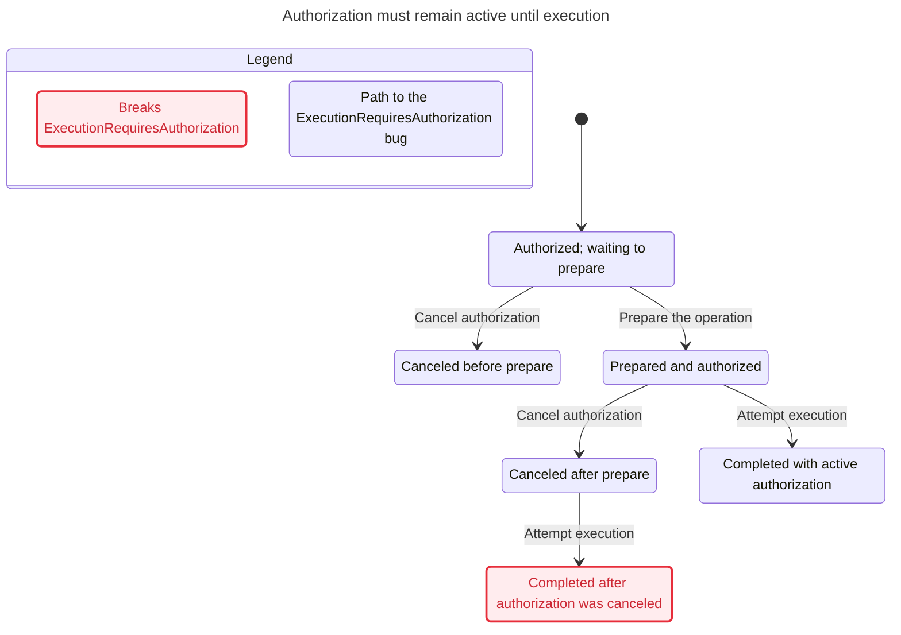
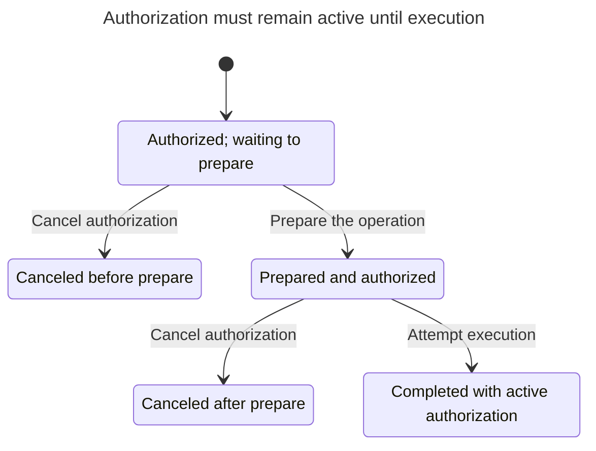

# Held-out authorization workflow evaluation

## Requirement and result

Raw requirement: **an operation may execute only while authorization is active, including cancellation after prepare**. A completed operation is terminal.

Only the copied `state-chart/SKILL.md` and its `references/execution.md` were consulted as instructions. No authoring conversation, upstream source, other skills, package changes, installations, network operations, global configuration changes, or permanent test suites were used. The trusted view is local, argument-only, and imports nothing.

| Rule / execution | Implementation A | Implementation B |
|---|---|---|
| `ExecutionRequiresAuthorization`: execution requires active authorization | **broken** | **holds** |
| `TypeOK`: all three state variables are Boolean | **holds** | **holds** |
| `NoDeadlock`: a successor exists, including legitimate terminal stuttering | **holds** | **holds** |
| CLI exit status | **1**, with a reported invariant counterexample | **0**, completed |
| Reported model states / steps | 6 / 14 | 5 / 13 |
| Chart states / arrows | 6 / 5 | 5 / 4 |
| Steps omitted because their chart state does not change | 9 | 9 |

No rule is reported as not checked. The A exit status is not a passing exit and is not ignored: its report and TLC log identify the concrete invariant failure. The original A TLC check stops on the invariant violation (13 generated, 6 distinct, 1 queued). Per the skill's documented rerun strategy, the final report includes the completed drawing and the remaining holding rules. The retained `tlc.out` is the original failing run, not a claim that that first run exhausted its queue. B's original log says “Model checking completed. No error has been found.” and reports 14 generated, 5 distinct, 0 queued. Generated-state totals differ from report step counts because they are different measures.

## Rule-specific counterexample and code replay

`ExecutionRequiresAuthorization` means an operation cannot execute after its authorization has been canceled. A's report gives this shortest, three-action path (report numbering):

0. Authorized; waiting to prepare — `{authorized:true, prepared:false, executed:false}`.
1. Prepare the operation — `{authorized:true, prepared:true, executed:false}`.
2. Cancel authorization — `{authorized:false, prepared:true, executed:false}`.
3. Attempt execution — `{authorized:false, prepared:true, executed:true}`: **breaks**.

`replay.mjs` parses the actual `result-A/tlc.out` counterexample, invokes the corresponding functions from `authorization.mjs` one step at a time, and asserts equality with every TLC state. It exited **0** and reproduced the violation at the final step. This is a reproduced bug in the supplied synthetic implementation A, not a production-code claim.

The same actions were exercised on implementation B. Execution remained false after cancellation. Additional executed B scenarios covered successful prepare/execute, terminal behavior under subsequent cancel/prepare/execute calls, cancellation before preparation, and execution without preparation. Every recorded B step satisfied the rule and every expected final state assertion passed. See `replay.stdout.json` for all 20 snapshots across A and B; `replay.stderr.txt` is empty. This is scenario evidence, not exhaustive JavaScript verification.

## Models, assumptions, and limitations

- `AuthorizationA.tla` and `AuthorizationB.tla` each model one operation, one authorization bit, one preparation bit, and one completion bit. The initial state is exactly `{authorized:true, prepared:false, executed:false}`. There are at most 8 possible Boolean valuations; the observed reachable counts are 6 and 5.
- Preparation sets `prepared` only while authorized. Cancellation clears authorization. A executes when prepared; B executes only when both prepared and authorized. Unsuccessful calls leave state unchanged rather than raising errors, matching the supplied semantics.
- Every call is atomic. There are no threads, asynchronous waits, network boundaries, failures, expiry timers, external side effects, multiple identities/operations, authorization renewal, reset, or persistence. A real check/use race inside an allegedly atomic execute operation is outside this model.
- Completion is terminal. The model enables only `Done == executed /\ UNCHANGED vars` after completion; JavaScript functions return immediately after completion. Consequently authorization cannot change after completion. Under this explicit assumption, `executed => authorized` captures active authorization at execution without a history variable. If post-completion cancellation were allowed, that state invariant would need an execution-time authorization snapshot instead.
- No `CONSTRAINT`, `ACTION_CONSTRAINT`, `VIEW`, `SYMMETRY`, or constants reduce exploration. No fairness assumption or liveness/property claim is introduced. Infinite waiting/no-op calls are allowed; `NoDeadlock` is not an eventual-execution guarantee.
- The projection is flat and distinguishes every reachable valuation. There is no merging, parallel-region assumption, or fallback. `step()` never returns null. The package automatically omits same-state steps: repeated/ineffective calls and terminal self-loops. These omissions are reported (9 per model), and no changing step or counterexample state is hidden. A drawn sink does not itself indicate a model deadlock.
- The charts are far below the 500-state budget. A's bug is terminal, so there are no omitted post-bug changing states.
- TLC checks this finite synthetic model/configuration. It does not establish arbitrary production-code correctness. JavaScript was written directly from the supplied semantics, not extracted from an external implementation.
- Both original TLC logs retain the throughput-GC warning. It was not suppressed or represented as fixed. The Java discovery helper initially failed, but the explicit existing Homebrew Java 17 executable worked; see `prerequisites.txt`.
- All authored inputs and retained evidence are in this isolated folder. The copied CLI itself used its default transient `statechart-*` scratch directories under the macOS temporary directory, visible in the raw TLC logs. No external repository files were edited. No renderer was invoked; image/render compatibility is unverified.

## Artifact inventory

All paths below are relative to:

`/var/folders/81/308ppjhd4_175x6vnb5flwmr0000gn/T/state-chart-heldout-rp65eve5`

- `AuthorizationA.tla`, `AuthorizationA.cfg`: original unguarded model and checking configuration.
- `AuthorizationB.tla`, `AuthorizationB.cfg`: guarded model and checking configuration.
- `view.mjs`: shared human-facing flat projection and action labels.
- `result-A/report.md`, `result-A/tlc.out`, `result-A/chart.mmd`: A's complete retained CLI evidence.
- `result-B/report.md`, `result-B/tlc.out`, `result-B/chart.mmd`: B's complete retained CLI evidence.
- `cli-A.stdout.txt`, `cli-A.stderr.txt`, `cli-B.stdout.txt`, `cli-B.stderr.txt`: captured process streams; both stderr files are empty.
- `commands.json`: exact CLI argument arrays, explicit environment selection, working directory, and observed exit statuses.
- `authorization.mjs`: actual synthetic JavaScript functions for both implementations.
- `replay.mjs`, `replay.stdout.json`, `replay.stderr.txt`, `replay-command.json`: concrete scenario execution and its process evidence.
- `prerequisites.txt`: runtime discovery, initial helper failure, explicit Java success, Node version, and pinned JAR checksum.
- `EVIDENCE.md`: this hand-off, including both complete Mermaid charts.

## Exact commands

Run from the isolated folder above. Original commands were:

```sh
PATH="/Users/namdoo/.nvm/versions/node/v24.14.1/bin:$PATH" \
TLA2TOOLS=/tmp/state-chart-tla2tools-1.7.4.jar \
JAVA=/opt/homebrew/opt/openjdk@17/bin/java \
./state-chart/scripts/statechart AuthorizationA.tla \
  --config AuthorizationA.cfg --view view.mjs --out result-A
# observed exit 1

PATH="/Users/namdoo/.nvm/versions/node/v24.14.1/bin:$PATH" \
TLA2TOOLS=/tmp/state-chart-tla2tools-1.7.4.jar \
JAVA=/opt/homebrew/opt/openjdk@17/bin/java \
./state-chart/scripts/statechart AuthorizationB.tla \
  --config AuthorizationB.cfg --view view.mjs --out result-B
# observed exit 0

/Users/namdoo/.nvm/versions/node/v24.14.1/bin/node replay.mjs
# observed exit 0
```

Fresh-output reproduction commands (not executed as an additional verification run):

```sh
PATH="/Users/namdoo/.nvm/versions/node/v24.14.1/bin:$PATH" \
TLA2TOOLS=/tmp/state-chart-tla2tools-1.7.4.jar \
JAVA=/opt/homebrew/opt/openjdk@17/bin/java \
./state-chart/scripts/statechart AuthorizationA.tla \
  --config AuthorizationA.cfg --view view.mjs --out result-A-reproduction

PATH="/Users/namdoo/.nvm/versions/node/v24.14.1/bin:$PATH" \
TLA2TOOLS=/tmp/state-chart-tla2tools-1.7.4.jar \
JAVA=/opt/homebrew/opt/openjdk@17/bin/java \
./state-chart/scripts/statechart AuthorizationB.tla \
  --config AuthorizationB.cfg --view view.mjs --out result-B-reproduction
```

The replay command consumes the original preserved `result-A/tlc.out`. No additional run is needed to establish the recorded evidence.

## A: unguarded implementation



## B: guarded implementation


